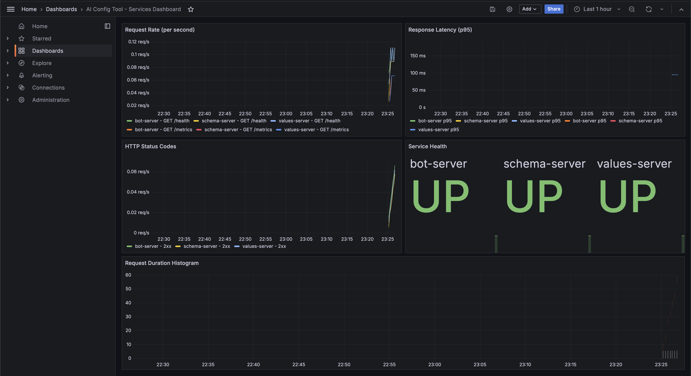

# AI-Assisted Application Configuration Tool

## Overview

AI-driven configuration management system that modifies application configs using natural language.

```
User: "set ledger service memory to 1024mb"
System: Returns updated JSON configuration validated against schema
```

---

## Architecture

```
                        ┌─────────────────────┐
                        │     USER REQUEST    │
                        └──────────┬──────────┘
                                   │
                    ┌──────────────▼──────────────┐
                    │   Nginx API Gateway (:80)   │  ◄── rate limiting, security headers
                    │        (profile: gateway)   │
                    └──────────────┬──────────────┘
                                   │
┌──────────────────────────────────▼───────────────────────────────┐
│                      BOT SERVICE (:7000)                         │
│  ┌────────────────────────────────────────────────────────────┐  │
│  │ Stage 1: Extract app name via LLM                          │  │
│  │   Input: user message                                      │  │
│  │   Output: "ledger"                                     │  │
│  └────────────────────────────────────────────────────────────┘  │
│             ▼                                ▼                   │
│  ┌─────────────────────┐        ┌─────────────────────────┐      │
│  │ Schema Service      │        │ Values Service          │      │
│  │ GET /ledger     │        │ GET /ledger         │      │
│  │ (:7001)             │        │ (:7002)                 │      │
│  └─────────────────────┘        └─────────────────────────┘      │
│                    │                      │                      │
│  ┌────────────────────────────────────────────────────────────┐  │
│  │ Stage 2: Modify config via LLM                             │  │
│  │   Input: user message + schema + current values            │  │
│  │   Output: JSON Patch ops → applied + schema-validated      │  │
│  └────────────────────────────────────────────────────────────┘  │
└──────────────────────────────────────────────────────────────────┘
                                │
                    ┌───────────▼──────────┐
                    │     Ollama LLM       │
                    │   qwen2.5:3b model   │
                    │      (:11434)        │
                    └──────────────────────┘

           ┌──────────────────────────────────────┐
           │     Monitoring (profile: monitoring) │
           │  Prometheus (:9090) → Grafana (:3000)│
           │  Scrapes /metrics from all services  │
           └──────────────────────────────────────┘
```

---

## Design Decisions

### 1. LLM Model Selection: qwen2.5

**Why qwen2.5?**
- Excellent JSON generation accuracy
- Strong instruction following capability
- Optimized for structured output tasks
- Available in multiple sizes (3b, 7b, 14b) for flexibility

**Model Size Trade-off:**
| Model | Memory | Accuracy | Use Case |
|-------|--------|----------|----------|
| qwen2.5:3b | ~2GB | Good | Limited resources |
| qwen2.5:7b | ~5GB | Better | Balanced |
| qwen2.5:14b | ~10GB | Best | High accuracy |

Default: `qwen2.5:3b` for Docker compatibility. Configurable via `.env` file.

### 2. Two-Stage Prompting Strategy

**Why Two Stages Instead of One?**

Stage 1: App Identification
- Lightweight query (no schema/values needed)
- Fast response time
- Clear separation of concerns

Stage 2: Configuration Modification
- Full context with schema and values
- Focused on specific application
- LLM answers with a **JSON Patch** (RFC 6902), not the whole config
- Patch is applied, then schema-validated before returning

**Why JSON Patch instead of the full config?**
- The values files are large; asking a 3B model to re-emit all of it is slow and it silently drops or reorders fields
- A patch is a few lines: faster to generate, and nothing outside the patch can change by accident
- The patch doubles as a human-readable diff (`changes` in the response) and as the audit-log entry
- If the model ignores instructions and returns the whole config anyway, the bot diffs it back into a patch

**Benefits:**
- Reduced token usage per request
- Better accuracy through focused context
- Easier debugging (know exactly where failures occur)
- Retry logic can target specific stage

**Trade-off:** Added latency (~1-2s extra) for improved reliability.

### 3. Technology Stack Choices

| Component | Choice | Reasoning |
|-----------|--------|-----------|
| Framework | FastAPI | Async support, auto-docs, type hints, production-ready |
| LLM Runtime | Ollama | Local execution, easy setup, model management |
| Validation | jsonschema | Standard library, well-documented, reliable |
| Containerization | Docker Compose | Profiles for optional services, single-command startup |
| API Gateway | Nginx | Rate limiting, security headers, reverse proxy |
| Monitoring | Prometheus + Grafana | Industry standard, pre-configured dashboards |
| CI/CD | GitHub Actions | Lint, test, build, security scan pipeline |
| Code Quality | Ruff + pre-commit | Fast Python linting, automated checks |

---

## Service Communication

### Inter-Service Communication

```
Bot Service ──HTTP GET──> Schema Service (/ledger)
                                │
                                └──> Returns JSON Schema

Bot Service ──HTTP GET──> Values Service (/ledger)
                                │
                                └──> Returns current config values

Bot Service ──HTTP POST──> Ollama (/api/chat)
                                │
                                └──> Returns LLM response
```

### Error Handling Between Services

- **Retry with exponential backoff**: 3 attempts with 1s, 2s, 4s delays
- **Circuit breaker**: Opens after 5 failures, resets after 30s
- **Timeout**: 120s for LLM calls, 30s for service calls

---

## End-to-End Request Flow

### Step-by-Step Example

**User Input:** `"set ledger service memory to 1024mb"`

1. **Bot receives request**
   ```json
   POST /edits {"text": "set ledger service memory to 1024mb"}
   ```

2. **Stage 1 - App extraction**
   - Bot sends prompt to LLM: "Extract app name from: ..."
   - LLM responds: "ledger"
   - Bot validates: ledger ∈ [storefront, ledger, orders] ✓

3. **Fetch schema and values**
   - GET http://schema-server:7001/ledger → JSON Schema
   - GET http://values-server:7002/ledger → Current values

4. **Stage 2 - Config modification**
   - Bot sends to LLM:
     - Original user message
     - JSON Schema (structure rules)
     - Current values (to modify)
   - LLM returns JSON Patch ops

5. **Validation**
   - Bot applies the patch and validates the result against the schema
   - If the patch is malformed or the result is invalid, retry up to 3 times
   - If valid, return `{app, changes, patch, config}` to the user

6. **Apply (optional, `"apply": true`)**
   - Bot sends the validated config to `PUT values-server:7002/ledger`
   - Values service appends an audit entry (author, message, patch, previous snapshot) to `data/values/.history/<app>.jsonl`
   - Then atomically replaces the values file (write temp file → rename)
   - `POST /undo/<app>` restores the snapshot of the latest change that hasn't been undone, and logs that as a new entry

7. **Response**
   ```json
   {
     "app": "ledger",
     "applied": false,
     "revision": null,
     "changes": [
       {"op": "replace", "path": "/workload/container/resources/memory/limitMiB", "old": 2048, "new": 1024}
     ],
     "patch": [{"op": "replace", "path": "/workload/container/resources/memory/limitMiB", "value": 1024}],
     "config": {"...": "full updated values"}
   }
   ```

---

## Trade-offs and Assumptions

### Trade-offs Made

| Decision | Pro | Con |
|----------|-----|-----|
| Two-stage prompting | Better accuracy | Added latency |
| Smaller model (3b) | Lower resource usage | Less accuracy |
| Preview by default, opt-in apply | Nothing changes by accident | Extra flag to save |
| JSONL audit log with snapshots | Simple, greppable, undo is trivial | Grows with every change; no compaction |
| Sync validation | Guaranteed correctness | Blocks response |
| Compose profiles | Optional monitoring/gateway | Slightly more complex config |

### Assumptions

1. **App names are known**: System only handles storefront, ledger, orders
2. **Schema is correct**: Provided schemas accurately describe valid configs
3. **Single writer**: Concurrent applies to the same app are last-write-wins (no revision check)
4. **All writes go through the API**: Hand edits to values files are not tracked and can be overwritten by an undo

---

## Configuration Paths Reference

Common configuration paths in the value files:

| Property | JSON Path |
|----------|-----------|
| Memory Limit | `workload.container.resources.memory.limitMiB` |
| CPU Limit | `workload.container.resources.cpu.limitMilliCPU` |
| Environment Variable | `workload.container.envs.[VAR_NAME]` |
| Container Image | `workload.container.image.tag` |
| Replicas | `workload.replicas` |

---

## Running the System

### Quick Start

```bash
# Start core services only
docker compose up -d

# Start with monitoring (Prometheus + Grafana)
docker compose --profile monitoring up -d

# Start with API gateway (Nginx)
docker compose --profile gateway up -d

# Start everything
docker compose --profile monitoring --profile gateway up -d
```

### Environment Configuration

All settings are configurable via `.env` file:

```bash
# Change LLM model
OLLAMA_MODEL=qwen2.5:7b

# Change service ports
BOT_PORT=7000
GRAFANA_PORT=3000
```

### Test Commands

```bash
# Memory change
curl -X POST http://localhost:7000/edits \
  -H "Content-Type: application/json" \
  -d '{"text": "set ledger service memory to 1024mb"}'

# Environment variable
curl -X POST http://localhost:7000/edits \
  -H "Content-Type: application/json" \
  -d '{"text": "set TENANT env to globex for orders service"}'

# CPU limit
curl -X POST http://localhost:7000/edits \
  -H "Content-Type: application/json" \
  -d '{"text": "lower cpu limit of storefront service to 80%"}'
```

### Via API Gateway (port 80)

```bash
# Same requests through Nginx (rate limited, security headers)
curl -X POST http://localhost:80/edits \
  -H "Content-Type: application/json" \
  -d '{"text": "set ledger service memory to 1024mb"}'
```

### Health Check

```bash
curl http://localhost:7000/health
# {"status": "healthy", "circuit_breaker": "closed"}
```

---

## Error Codes

| Code | Meaning | Resolution |
|------|---------|------------|
| 400 | Invalid input (empty) | Provide valid input |
| 404 | App not found | Use: storefront, ledger, orders |
| 409 | Nothing to undo | Every change for this app is already reverted |
| 500 | Server/validation error | Check logs, retry |
| 502 | LLM unavailable | Wait for Ollama, check model |
| 503 | Circuit breaker open | Wait 30s for reset |

---

## DevOps Features

### Makefile

Development workflow shortcuts:

```bash
make help              # Show all commands
make build             # Build Docker images
make up                # Start core services
make down              # Stop all services
make monitoring-up     # Start with Prometheus + Grafana
make gateway-up        # Start with Nginx API gateway
make full-up           # Start everything
make test              # Run all unit tests
make test-coverage     # Run tests with coverage report
make test-integration  # Run integration test suite
make lint              # Run code linting (ruff)
make clean             # Remove containers, images, and caches
```

### Docker Compose Profiles

Services are organized with profiles to keep the core simple while allowing optional features:

| Profile | Services | Use Case |
|---------|----------|----------|
| *(default)* | ollama, schema-server, values-server, bot-server | Core system |
| `monitoring` | prometheus, grafana | Observability |
| `gateway` | nginx | API gateway with rate limiting |

### GitHub Actions CI/CD

Automated pipeline on push/PR (`.github/workflows/ci.yml`):

| Job | Description |
|-----|-------------|
| **Lint** | Ruff checks on all services |
| **Test** | Pytest with coverage on each service (matrix strategy) |
| **Docker Build** | Docker Compose build + config verification |
| **Security Scan** | Trivy vulnerability scan on all container images |

### Nginx API Gateway

- **Rate Limiting**: 10 requests/second per IP with burst of 20
- **Security Headers**: X-Content-Type-Options, X-Frame-Options, X-XSS-Protection
- **Reverse Proxy**: Routes `/edits`, `/history/*`, `/undo/*`, `/schemas/*`, `/values/*` (read-only: `GET` only)
- **Metrics Proxy**: Aggregated access at `/metrics/schema`, `/metrics/values`, `/metrics/bot`

### Monitoring Stack

- **Prometheus**: Scrapes `/metrics` from all services every 15s, 7-day retention
- **Grafana**: Pre-configured dashboard with request rate, latency, status codes, service health
- **Access**: Grafana at `http://localhost:3000` (admin/admin)




### Prometheus Metrics

All services expose `/metrics` endpoint:

```bash
curl http://localhost:7001/metrics
curl http://localhost:7002/metrics
curl http://localhost:7000/metrics
```

Metrics include: request count, latency histograms, HTTP status codes, Python runtime info.

## Project Structure

```
ai-config-tool/
├── .env                          # Environment variables (ports, model, limits)
├── .gitignore
├── .pre-commit-config.yaml       # Pre-commit hooks configuration
├── docker-compose.yml            # Service orchestration with profiles
├── Makefile                      # Development workflow shortcuts
├── pyproject.toml                # Ruff + pytest configuration
├── README.md                     # Project overview
├── ARCHITECTURE.md               # This documentation
├── LICENSE                       # Apache License 2.0
├── NOTICE                        # Attribution notice
├── test_integration.sh           # Integration test script
│
├── .github/
│   └── workflows/
│       └── ci.yml                # CI/CD pipeline (lint, test, build, security)
│
├── bot-server/                   # Main bot service (port 7000)
│   ├── app.py                    # FastAPI app with LLM integration
│   ├── prompts.py                # LLM prompt templates
│   ├── Dockerfile                # Multi-stage build
│   ├── .dockerignore
│   ├── requirements.txt
│   ├── pytest.ini
│   └── tests/
│       └── test_app.py           # 45 unit tests
│
├── schema-server/                # Schema service (port 7001)
│   ├── app.py                    # FastAPI app serving JSON schemas
│   ├── Dockerfile
│   ├── .dockerignore
│   ├── requirements.txt
│   ├── pytest.ini
│   └── tests/
│       └── test_app.py           # 7 unit tests
│
├── values-server/                # Values service (port 7002)
│   ├── app.py                    # FastAPI app serving config values
│   ├── Dockerfile
│   ├── .dockerignore
│   ├── requirements.txt
│   ├── pytest.ini
│   └── tests/
│       └── test_app.py           # 21 unit tests
│
├── cli/                          # Terminal client (stdlib only)
│   ├── configbot.py              # preview / --apply / history / undo
│   └── tests/
│       └── test_configbot.py     # 16 unit tests
│
├── data/
│   ├── schemas/                  # JSON Schema definitions
│   │   ├── storefront.schema.json
│   │   ├── orders.schema.json
│   │   └── ledger.schema.json
│   └── values/                   # Current configuration values
│       ├── storefront.value.json
│       ├── orders.value.json
│       └── ledger.value.json
│
├── monitoring-server/
│   ├── prometheus/
│   │   └── prometheus.yml        # Scrape targets configuration
│   └── grafana/
│       ├── provisioning/
│       │   ├── datasources/
│       │   │   └── datasource.yml  # Explicit UID for dashboard binding
│       │   └── dashboards/
│       │       └── dashboard.yml
│       └── dashboards/
│           └── services.json     # Pre-built Grafana dashboard
│
└── gateway-server/
    ├── nginx.conf                # Reverse proxy + rate limiting config
    └── Dockerfile                # Nginx Alpine with healthcheck
```