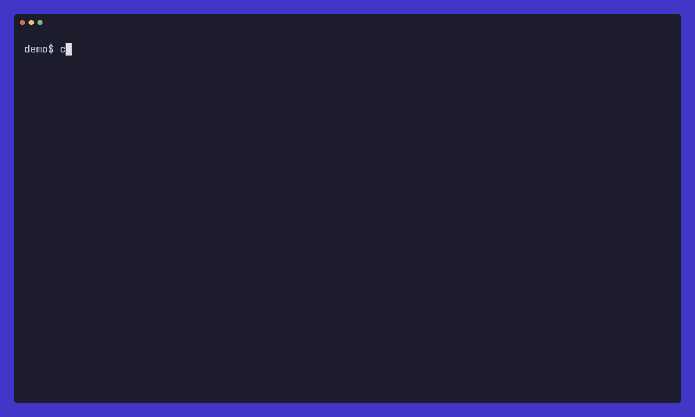
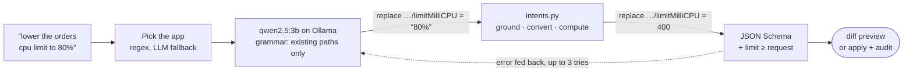

<div align="center">

# plainpatch

**Edit service configs in plain English. A local model reads the request; code does the math and checks every value.**

[](https://github.com/metharda/plainpatch/actions/workflows/ci.yml)
[](docs/evals.md)
[](https://ollama.com)
[](pyproject.toml)
[](LICENSE)


<br>
<sub>Real time against qwen2.5:3b on an RTX 4070. Nothing is cut or mocked.</sub>

</div>

plainpatch turns requests like *"lower the orders cpu limit to 80%"* into a validated [JSON Patch](https://www.rfc-editor.org/rfc/rfc6902) against a service's config. It shows you the diff, and saves it with an audit entry you can undo when you ask. It runs entirely on your machine: three small FastAPI services, a standard-library CLI, and a 3B model on [Ollama](https://ollama.com). The model only *extracts* what to change. Everything that has to be exact, from units and percentages to which fields exist and whether a value really came from your words, is done and checked by code.

- **The model can't invent fields.** Ollama's structured outputs get a grammar built from the current config, so every path is one that exists and every value has the right type.
- **Code does the arithmetic.** The model copies `"80%"`, `"+512mb"` or `"1.5 cores"` as you wrote it, and code converts by the field's unit (`…MiB`, `…MilliCPU`, `…Seconds`).
- **Every value is grounded in your request.** Vague requests ("make it faster") and invented values get a 422 with the reason, never a silent edit.
- **Preview first, then apply, audit and undo.** Writes are atomic, concurrent applies can't overwrite each other, and each change records who made it and why.
- **Measured, not guessed.** 69 labeled requests scored on the exact resulting config: 39/69 at the start, **61/69** now, at a median of 0.3 s per request ([evals](docs/evals.md)).
- **Cheap to run.** About 1.2 LLM calls per request, an 800-token prompt that's mostly served from Ollama's cache, and Prometheus metrics for all of it.

## Quick start

**You need:** Docker with Compose v2 and about 4 GB of free RAM. An NVIDIA GPU is optional but makes requests about 10× faster.

```bash
git clone https://github.com/metharda/plainpatch.git && cd plainpatch
cp .env.example .env
docker compose up -d                    # first start pulls qwen2.5:3b (~2 GB)
curl -s localhost:7000/health           # {"status":"healthy","circuit_breaker":"closed"}
```

Then try a change:

```bash
alias ppatch="python3 $(pwd)/cli/ppatch.py"
ppatch "lower the orders cpu limit to 80%"            # preview: 500 → 400
ppatch "lower the orders cpu limit to 80%" --apply    # saved as revision #1
ppatch undo orders                                    # back to 500
```

> [!TIP]
> Everything the CLI does is one HTTP call: `curl -s localhost:7000/edits -H 'Content-Type: application/json' -d '{"text": "give ledger 6gb of memory"}'`. See [Usage](docs/usage.md) for the walkthrough and [API](docs/api.md) for every field.

## How it works



1. **Route.** A regex picks the app when the request names one. App names inside values, like `storefront:2.0`, don't count, and only otherwise is the model asked.
2. **Extract.** The model gets the current config and a grammar listing every path that exists. It answers with JSON Patch-style operations and writes quantities exactly as you did.
3. **Compile.** `bot-server/intents.py` checks that every value comes from your request, converts units, applies percentages to the current value, drops no-ops, and clamps requests under a lowered limit.
4. **Validate.** The patch is applied in memory and checked against the app's JSON Schema. If anything fails, the exact error goes back to the model, up to three attempts in total.
5. **Respond.** You get the diff, the model's raw intent and the resulting config. With `--apply`, the values service writes atomically and refuses the write if someone else changed the config in the meantime.

The details, including why each check exists, are in [Intents](docs/intents.md) and [Architecture](docs/architecture.md).

## Evals

| Stage | Score (69 requests) | Median | Edit prompt |
| :--- | :---: | :---: | :---: |
| Structured outputs, full schema in the prompt | 39/69 | 0.49 s | ~2,560 tokens |
| + regex router, request-last prompt, cache | 53/69 | 0.35 s | ~2,600 |
| + grammar of existing paths, schema dropped from the prompt | 58/69 | 0.36 s | ~600 |
| + code does units and arithmetic, values grounded in the request | **61/69** | **0.32 s** | **~780** |

These are qwen2.5:3b numbers on an RTX 4070, scored on exact configs with no LLM judge, across three sets, two of them written later as held-out checks. Seven of the eight misses are refusals with a reason. One is a wrong edit, a two-field timeout request that hit the probe timeouts instead, and the [evals page](docs/evals.md#known-misses) explains it along with the method and the ideas that didn't work. Reproduce with `make eval`.

> [!NOTE]
> Ten parallel testers then probed a live stack with about 500 adversarial requests (routing, units, injection, concurrency, the API, the CLI). Everything they broke is fixed and tested ([details](docs/evals.md#adversarial-testing)).

## Day to day

| Task | Command |
| :--- | :------ |
| Preview a change | `ppatch "set ledger replicas to 3"` |
| Apply it | `ppatch "set ledger replicas to 3" --apply --author you` |
| See what changed | `ppatch history ledger` |
| Undo the last change | `ppatch undo ledger` |
| Add an env var | `ppatch "add env LOG_LEVEL=debug to storefront"` |
| Watch the LLM metrics | `docker compose --profile monitoring up -d` → Grafana on `:3000` |
| Put nginx in front | `docker compose --profile gateway up -d` (rate limited, `/values/` read-only) |
| Run the tests / the evals | `make test` · `make eval` |

## Requirements

| | |
| :--- | :--- |
| Runtime | Docker with Compose v2, or Python 3.12 to run the services directly |
| Model | `qwen2.5:3b` on Ollama 0.30 or newer (pulled automatically by Compose) |
| Memory | 4 GB free; the model uses about 2.5 GB of RAM or VRAM |
| GPU | Optional. Median 0.3 s per request on an RTX 4070; expect several seconds on CPU |

## Limitations

- It edits fields that already exist, plus new env vars. It doesn't create new sections of a config.
- One app per request. Requests that name several apps are refused with a message.
- Multi-field requests whose field names overlap, such as "read and send timeouts" next to probe timeouts, are the weakest spot (see [known misses](docs/evals.md#known-misses)).
- No authentication. `author` is self-reported. Run it on a trusted network or behind your own auth ([Security](docs/security.md)).
- Undo restores the snapshot taken before a change, so hand edits made to a values file in between are overwritten.

## How it compares

| Approach | Good for | Trade-off |
| :--- | :------- | :-------- |
| **plainpatch** | Plain-English edits to schema-backed configs, with preview, audit and undo, on local hardware | Needs a schema and a running model; edits existing fields only |
| Editing YAML/JSON by hand, `kubectl patch` | Full control, no moving parts | You do the unit math and remember every path |
| Asking a chat assistant to rewrite the file | Any format, no setup | Rewrites the whole file, can't be validated before you paste it, and the data leaves your machine |
| Helm values / Kustomize overlays | Repeatable, reviewed changes in Git | Not conversational; each change is a manual edit |
| [instructor](https://github.com/567-labs/instructor), [outlines](https://github.com/dottxt-ai/outlines) | Building blocks for structured LLM output | Libraries, not an end-to-end editor with grounding and audit |

## Documentation

| Document | What's in it |
| :------- | :----------- |
| [Usage](docs/usage.md) | Walkthrough, every CLI command and flag, HTTP examples |
| [API](docs/api.md) | Every endpoint, field, response and status code |
| [Intents](docs/intents.md) | The grammar, quantity parsing, grounding, routing and LLM settings, and why each exists |
| [Architecture](docs/architecture.md) | Components, request flow, code map, invariants, design decisions |
| [Evals](docs/evals.md) | Method, results per stage, failed ideas, known misses, how to run and extend |
| [Operations](docs/operations.md) | Configuration, compose profiles, monitoring, metrics, errors and what to do |
| [Security](docs/security.md) | Threat model and how to report a vulnerability |
| [Development](docs/development.md) | Working on the code, adding an app, re-recording the demo |
| [Research notes](docs/research/) | The cited research behind the design |

## License

Apache License 2.0. See [LICENSE](LICENSE) and [NOTICE](NOTICE).
