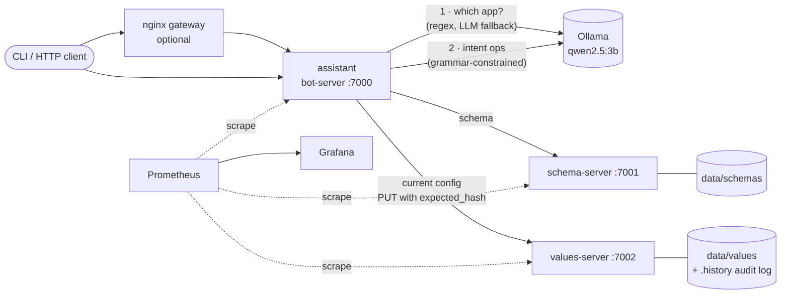

# Architecture

The components, how a request flows through them, where the code lives, the rules every change has to keep, and the design decisions behind them. How the model's output is checked has its own page: [intents.md](intents.md).

## Bird's-eye view

A user writes a change request in plain English. The system turns it into a validated [RFC 6902](https://www.rfc-editor.org/rfc/rfc6902) JSON Patch against one app's config, shows the diff, and optionally saves it with an audit entry that can be undone.

The language model is a component, not the system. It only *extracts* what to change. Code decides whether that extraction is grounded in the request, computes the final values, and validates the result.

A request goes through these stages:

1. **Route.** The assistant picks the target app with a regex when the request names exactly one app, skipping names in value positions such as `image to storefront:2.0`. Only otherwise does it ask the LLM, constrained to `{"app": enum[...]}`.
2. **Extract.** The assistant sends the current config (minified) and the request to Ollama with a `format` JSON Schema built from that config. Every `path` is an enum of paths that exist, and number fields take the user's own quantity string (`"80%"`, `"+512mb"`).
3. **Compile.** `bot-server/intents.py` grounds every value in the request, converts units by field suffix, does the arithmetic, drops no-ops, clamps requests under lowered limits, and emits the patch.
4. **Validate.** The patch is applied in memory and checked against the app's full JSON Schema and the limit ≥ request rule. On failure, the exact error goes back to the model, up to 3 attempts in total.
5. **Respond or persist.** Preview returns `changes`, `unchanged`, the raw `intent`, the `patch` and the resulting `config`. With `apply`, the assistant sends a `PUT` to the values service with the hash of the config it read, and a stale write gets 409.

## Code map

| Path | What lives there |
|---|---|
| `bot-server/app.py` | The assistant: HTTP API, app routing, the Ollama client (retries, circuit breaker, warm-up), the edit loop with error feedback, the patch cache, Prometheus metrics. |
| `bot-server/intents.py` | Pure functions, no I/O. Builds the per-config `format` grammar, parses quantity strings, converts units, grounds values in the request, compiles intents to RFC 6902, splits no-ops and clamps requests. Most of the logic worth reading is here. |
| `bot-server/prompts.py` | The two system prompts, the retry-feedback template, and the list of known apps. |
| `values-server/app.py` | Owns config files: reads, atomic writes (temp file then rename), the append-only JSONL audit log, undo, and the `expected_hash` stale-write check. |
| `schema-server/app.py` | Serves `data/schemas/<app>.schema.json`. Read-only. |
| `cli/ppatch.py` | Terminal client. Standard library only. |
| `data/` | One JSON Schema and one current-values file per app. |
| `evals/` | `cases.py`: 69 labeled requests in three sets. `run.py`: drives the real services against a real Ollama and scores exact resulting configs. |
| `gateway-server/`, `monitoring-server/` | nginx (rate limiting, read-only `/values/`), Prometheus scrape config, Grafana dashboard. |
| `docs/` | These pages, the demo tapes, and cited research notes. |

## Invariants

These are the rules a change must not break. Most have a test that fails if they do.

- **LLM output is untrusted until compiled.** Nothing from the model reaches a config without passing `compile_intents()`: an existing path, a value grounded in the request, units resolved by code, and a schema-valid result.
- **The model never does arithmetic that counts.** Number fields take quantity strings. If the model computes a value itself, the value must match what the request's numbers imply for the current value.
- **Preview is the default.** Only `apply: true` (a strict boolean) writes, and only through the values service.
- **Every write is audited and reversible.** The audit entry is appended before the file is replaced, and a failed replace removes the entry again. Undo walks back one unreverted change at a time and is logged too.
- **No lost updates.** Writes from the assistant carry `expected_hash`, and the values service refuses a write based on a stale read.
- **One `num_ctx` everywhere.** The warm-up and both LLM calls send the same context size, because a different value makes Ollama reload the model.
- **The static prompt comes first.** The request is the last thing in the prompt, so Ollama's prefix cache can reuse everything before it.
- **The CLI has no third-party dependencies.**

## Cross-cutting concerns

- **Errors:** client mistakes are 4xx with a one-line `detail`. 422 means the request couldn't become a valid change, and the detail gives the last reason. Upstream failures are 502 or 503 and never echo internal hostnames.
- **Observability:** each service exposes `/metrics`. The assistant adds LLM call, latency, token, routing, cache, attempt and rejection metrics ([reference](operations.md#metrics)).
- **Testing:** unit tests mock the LLM (`pytest` in each service). The evals measure the real model ([how-to](evals.md#running-the-evals)).

## Design decisions

### The model emits constrained intents, not patches

**Context.** A 3B local model writing RFC 6902 patches freely invents JSON Pointers, swaps units ("5gb" → 5242), and sometimes loops until it hits the token limit. Retries with error feedback can't fix an invented path.

**Decision.** Both LLM calls use Ollama's `format` field. The edit call gets a JSON Schema generated from the current config:

- every `path` is an enum of paths that exist
- value types are pinned per path (text, boolean, or number/quantity string)
- adding a map entry is its own operation shape with `key` required
- `operations` has `maxItems: 8`

The op names stay JSON Patch's own (`replace`, `add`, `remove`), because custom names measurably confused the model.

**Consequences.**

- Invented paths and type errors can't happen, so retries are spent on real problems.
- The app's schema doesn't need to be in the prompt (about 800 tokens instead of 2,500).
- A field that doesn't exist yet can't be set. That's acceptable for editing existing configs, and new map keys are covered by the `add` shape.

### Code does units, arithmetic and grounding

**Context.** Even with constrained output, the model got numbers wrong: "50% of 500" became 750, and "0.5gb" became `512m`. It also invented values for vague requests ("make it faster") and env vars nobody asked for.

**Decision.** Number fields take the user's own quantity string (`"80%"`, `"+512mb"`, `"1.5 cores"`). `intents.py` converts by field suffix (`…MiB`, `…MilliCPU`, `…Seconds`) and applies relative changes to the current value. Every value must also be *grounded*:

- text must appear in the request
- a number must follow from the request's quantities (the amount itself, ± it, a percentage, double or half)
- a new env var must be asked for, named, and given a value

**Consequences.**

- Correct arithmetic is guaranteed. A model that does the math correctly itself is accepted; one that gets it wrong is rejected with feedback.
- Vague or invented changes become a 422 with a reason instead of a silent edit.
- Some legitimate phrasings ("set it like the other service") are refused. That's the price of never writing a value the user didn't give.

### RFC 6902 patches, schema validation, preview by default

**Context.** Regenerating a whole config is slow and lets unrelated fields drift. Users need to see what will change before it happens.

**Decision.** Every change is a minimal RFC 6902 patch, applied in memory and validated against the app's JSON Schema plus the Kubernetes limit ≥ request rule. When a lowered limit crosses a request the user didn't mention, the request is clamped and shown in `changes`. Responses are previews unless `apply` is a strict `true`.

**Consequences.**

- Diffs are small, reviewable and reversible.
- The schema is the contract: tightening it immediately tightens what the assistant can produce.
- Rules the schema can't express live in code (`check_limits`) and need their own tests.

### Three services, optimistic concurrency, append-only audit

**Context.** Configs are shared state. The LLM-facing service should be stateless and replaceable; the store must not lose writes or history.

**Decision.** - **schema-server** serves schemas (read-only).
- **values-server** owns the files. It writes atomically (temp file then rename) and appends a JSONL audit entry before replacing the file, removing the entry again if the replace fails. It refuses a `PUT` whose `expected_hash` doesn't match the current config.
- **bot-server** (the assistant) reads both, talks to the LLM, and writes only through the values service.

**Consequences.**

- Concurrent applies can't silently overwrite each other: one wins and the rest get 409 and retry against the new config.
- Undo is exact, because each entry stores the full previous snapshot. History grows with config size × number of writes, with no compaction yet.
- The values service has no schema knowledge, so it must not be exposed directly. Compose binds it to localhost and the gateway makes `/values/` read-only.

### A standard-library-only CLI

**Context.** A client for a self-hosted tool should run anywhere Python does, with no virtualenv or install step.

**Decision.** `cli/ppatch.py` uses only the standard library (`urllib`, `argparse`, `json`). It renders diffs, works without a TTY, and turns every server or transport problem into a one-line message with exit code 1.

**Consequences.**

- `python3 cli/ppatch.py` works on a fresh machine.
- No retries, streaming or auth helpers. Those would justify a dependency if they're ever needed.
